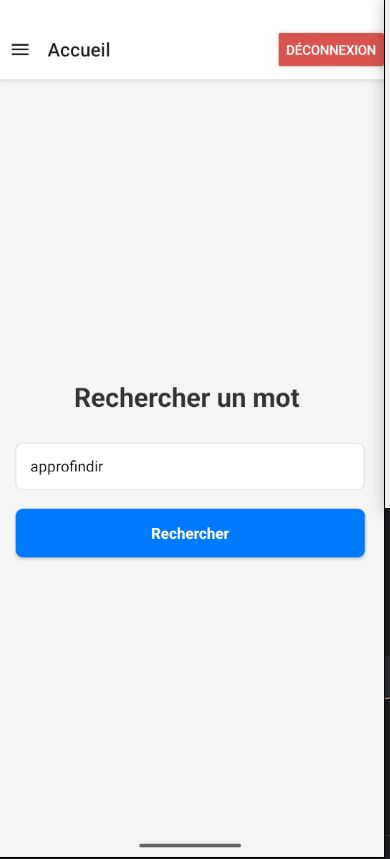
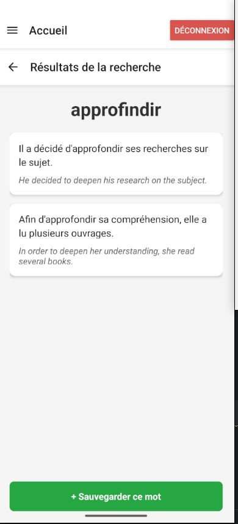
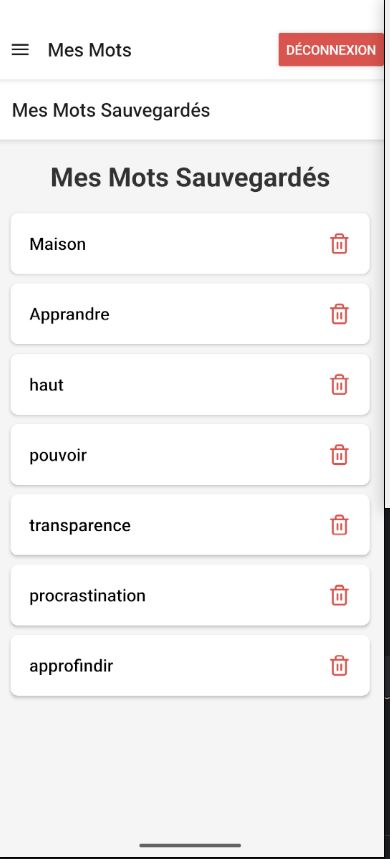

# FleMot AI

FleMot AI helps French learners study words in context. The mobile app lets users search for a French word, read generated sentences with translations, and keep a personal vocabulary list. Its interface is in French.

## Main features

- Email/password registration and sign-in with Firebase Authentication, plus a Google sign-in flow.
- French example sentences and translations generated through the backend's Gemini integration.
- Save words with their examples, browse saved vocabulary, reopen examples, and delete entries.
- Local vocabulary caching with a fallback when fetching the server list fails.
- Backend duplicate detection and a ten-word save limit for standard accounts.
- Translation language stored per user, defaulting to English; changing it is available through the API only.

## Screenshots

Screenshots from an earlier development version.

| Word search | Generated examples | Saved vocabulary |
| --- | --- | --- |
|  |  |  |

## Technology stack

| Area | Technologies |
| --- | --- |
| Mobile | React Native 0.81.1, React 19.1, TypeScript, React Navigation, Axios |
| Authentication and storage | Firebase Authentication, Google Sign-In, Keychain, AsyncStorage |
| Backend | ASP.NET Core / .NET 9, JWT bearer authentication, Swagger |
| Database and generation | MongoDB, MongoDB .NET Driver, Gemini REST API (`gemini-2.5-flash-lite`) |
| Tests | xUnit, Moq, ASP.NET Core test hosting, Testcontainers, Jest |

The mobile app sends Firebase ID tokens to the API. Backend controllers call services and MongoDB repositories; Gemini requests stay on the server.

Code lives in `backend/FleMot.Api/` and `mobile-app/FleMotApp/`; backend tests are in `backend/FleMot.Api.Tests/`. Docker definitions and a backend GitHub Actions workflow are also included.

## Local setup

Start each terminal at the repository root unless stated otherwise. Replace `<PLACEHOLDERS>` with your own values. Backend examples use PowerShell. See [Project status](#project-status) for the remaining setup issues.

### 1. Prerequisites

- .NET 9 SDK and runtime: the backend and test projects target `net9.0`.
- Node.js 20.19.4 or newer and npm, matching the locked React Native package's requirement.
- A local MongoDB installation; Compose specifies MongoDB 8.
- Android Studio, a compatible JDK, and an emulator or USB-debugging device. Configure `JAVA_HOME`, `ANDROID_HOME`, and platform tools.
- Android SDK/Build Tools 36 and NDK `27.1.12297006`. Minimum device API is 24; the project uses Gradle wrapper `8.14.3`. The JDK version is not pinned.
- A Firebase project and a backend Gemini API key you control. Firebase sign-in and generation need internet access.

### 2. Start MongoDB

Start your local MongoDB service, or create a data directory and run this in a separate terminal:

```powershell
mongod --dbpath "<EXISTING_DATA_DIRECTORY>" --bind_ip 127.0.0.1 --port 27017
```

Keep MongoDB running and use its connection string in step 4, including authentication details if enabled. Collections are created through API writes; no seed command is provided.

### 3. Configure Firebase Authentication

1. Enable **Email/Password** in your Firebase project's Authentication settings. Enable **Google** if using Google sign-in.
2. Register the Android app as `com.flemot.ia`, matching `android/app/build.gradle`.
3. Place your Android client configuration at `mobile-app/FleMotApp/android/app/google-services.json`.
4. For Google sign-in, register the signing certificate fingerprints and replace `GoogleSignin.configure`'s `webClientId` in `mobile-app/FleMotApp/index.js` with your **Web OAuth client ID**.
5. Use the same Firebase project ID for the backend's `Firebase__ProjectId` below.

Firebase client configuration identifies the project; keep the Gemini secret on the backend only.

### 4. Configure and start the backend

In a new PowerShell terminal, from the repository root:

```powershell
cd backend
$env:MongoDbSettings__ConnectionString = "<YOUR_LOCAL_MONGODB_CONNECTION_STRING>"
$env:MongoDbSettings__DatabaseName = "FleMotLocal"
$env:Firebase__ProjectId = "<YOUR_FIREBASE_PROJECT_ID>"
$env:GEMINI_API_KEY = "<YOUR_BACKEND_GEMINI_API_KEY>"

dotnet restore FleMot.sln
dotnet run --project FleMot.Api/FleMot.Api.csproj --launch-profile http --urls http://0.0.0.0:5081
```

Do not commit credentials. The API reads process environment variables; `dotnet run` does not automatically load a `.env` file.

Swagger: `http://localhost:5081/swagger`. The command binds port 5081 on all interfaces for device access; use a trusted local network and appropriate firewall rules.

### 5. Configure and start the Android app

The mobile app currently hardcodes a tunnel address in three files. Replace all three before running:

| File under `mobile-app/FleMotApp/` | URL to configure |
| --- | --- |
| `src/services/api.ts` | Axios `baseURL`: `<API_BASE_URL>` |
| `src/screens/LoginScreen.tsx` | Registration URL: `<API_BASE_URL>/auth/register` |
| `src/screens/SignUpScreen.tsx` | Registration URL: `<API_BASE_URL>/auth/register` |

Use `http://10.0.2.2:5081/api` for an Android Studio emulator, or `http://<COMPUTER_LAN_IP>:5081/api` for a physical device on the same network. Allow the device to reach port 5081. Android debug builds permit local HTTP; the mobile app has no `.env` loader.

After configuring the URLs, install dependencies and start Metro:

```sh
cd mobile-app/FleMotApp
npm ci
npm start
```

In a second terminal, from the repository root, with an emulator running or a device connected:

```sh
cd mobile-app/FleMotApp
npm run android
```

Use the mobile directory's `package.json`. Metro uses port 8081; for USB devices, `adb reverse tcp:8081 tcp:8081` can provide access to it. API access is configured separately above.

## Tests and checks

Backend, from the repository root:

```sh
cd backend
dotnet test FleMot.sln
```

Backend tests cover service rules, mocked Gemini parsing, and HTTP endpoints. Integration tests start MongoDB 7.0 through Docker and require a running Linux-container engine. They do not test live Firebase or Gemini services.

Mobile, from the repository root after dependency installation:

```sh
cd mobile-app/FleMotApp
npm test -- --runInBand
npm run lint
npx --no-install tsc --noEmit
```

The mobile suite contains a render smoke test.

## Project status

Android is the current target. iOS is not supported yet because its native Firebase and Google Sign-In configuration is incomplete.

Subscriptions and payments are not implemented; the subscription screen is a placeholder. Vocabulary is cached locally, but offline changes are not queued for synchronization.

Remaining setup issues:

- Token refresh currently uses the Web Firebase SDK while sign-in uses the native SDK; align the authentication code on the native SDK.
- For Docker development, use an SDK image with a matching entrypoint and working directory for `dotnet watch`. Before deploying, map database variables to `MongoDbSettings__ConnectionString` and `MongoDbSettings__DatabaseName`.
